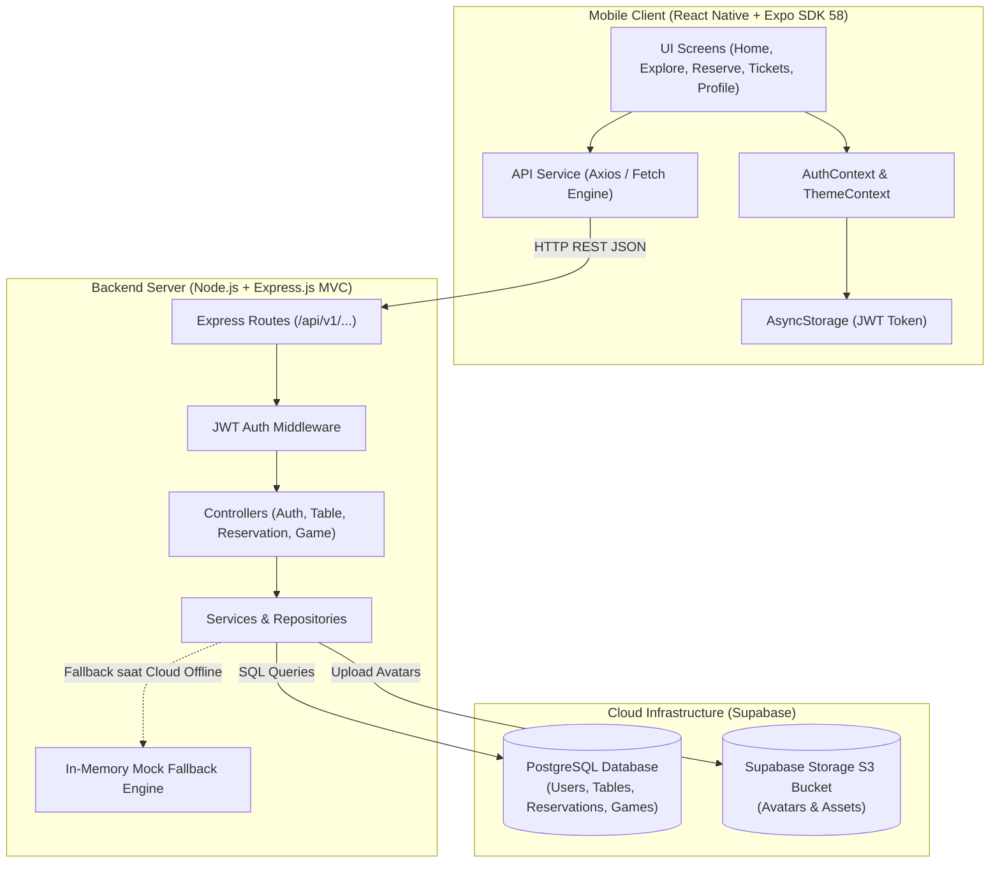

# Panduan Asistensi Tugas Akhir: MeepleCafe Mobile App
**Praktikum Pemrograman Perangkat Bergerak (PPB) 2026**

---

## 1. Identitas Proyek & Mahasiswa
- **Nama Aplikasi:** MeepleCafe (Board Game Cafe Mobile App & Reservation System)
- **Nama Pengembang:** Lanjar Setiawan
- **NIM:** 21120124120023
- **Kelompok:** 16 | **Shift:** 3
- **Platform Sasaran:** Android (Cross-Platform Ready via React Native / Expo)

### Akun Uji Coba Demo (Demo Accounts):
| Peran (Role) | Username | Password | Deskripsi Penggunaan Saat Demo |
| :--- | :--- | :--- | :--- |
| **Admin** | `admin` | `Admin@123` | Akses penuh **CRUD Katalog Game** (Tambah game baru, edit data game, hapus game). |
| **Member** | `lanjar` | `123` | Demonstrasi fitur reservasi meja, tiket aktif, dan edit profil pengguna biasa. |

---

## 2. Latar Belakang & Masalah (Problem Statement)
### Latar Belakang
Board game cafe adalah tempat hiburan sosial yang mengombinasikan kafe/makanan dengan penyewaan ratusan koleksi permainan papan (*board games*). Namun, operasional konvensional sering mengalami kendala:
1. **Ketidakpastian Meja & Waktu Tunggu:** Pengunjung sering datang tanpa mengetahui apakah meja tersedia, dan berapa lama meja tersebut akan dipakai oleh pengunjung sebelumnya.
2. **Katalog Permainan Fisik yang Kurang Terstruktur:** Pelanggan kesulitan mencari game yang sesuai dengan jumlah pemain, tingkat kesulitan, atau kategori tanpa bertanya manual ke Game Master.
3. **Pencatatan Tiket & Pemesanan Manual:** Masih menggunakan nota kertas atau chat WhatsApp yang rentan terjadi *double-booking* atau salah jadwal.

### Solusi yang Diberikan MeepleCafe
MeepleCafe adalah aplikasi mobile berbasis React Native yang menyediakan:
- **Katalog Board Game Digital:** Filter berdasarkan jumlah pemain, kategori, dan tingkat kesulitan.
- **Sistem Reservasi Meja Cerdas:** Pencegahan bentrok jadwal otomatis menggunakan algoritma pengecekan interval waktu.
- **Pass Tiket Digital (My Tickets):** Tiket terisolasi per akun user secara aman dengan indikator status otomatis (*Upcoming, Active, Expired*).
- **Dual-Mode Akses (Tamu vs Member):** Fleksibilitas bagi pengguna baru untuk melihat menu & katalog tanpa harus langsung registrasi.

---

## 3. Teknologi yang Digunakan (Tech Stack Breakdown)

### A. Frontend (Mobile Client)
| Teknologi | Versi / Library | Fungsi & Peran |
| :--- | :--- | :--- |
| **Framework** | React Native (Expo SDK 58) | Kerangka kerja pengembangan mobile cross-platform berbasis komponen deklaratif. |
| **Navigasi** | `@react-navigation/native`, `@react-navigation/stack`, `@react-navigation/bottom-tabs` | Manajemen navigasi multi-layar, bottom tab navigation, dan deep navigation stack. |
| **State Management** | React Context API (`AuthContext`, `ThemeContext`) | Manajemen state global untuk sesi login, data token JWT pengguna, dan preferensi tema. |
| **Penyimpanan Lokal** | `@react-native-async-storage/async-storage` | Menyimpan token otentikasi JWT dan data sesi lokal agar login tetap persisten saat aplikasi dibuka kembali. |
| **Komponen UI & Ikon** | React Native Paper & `@expo/vector-icons` (Ionicons) | Komponen UI bergaya Material Design yang konsisten, modern, dan responsif. |
| **Media & Kamera** | `expo-image-picker` | Integrasi kamera dan galeri perangkat untuk mengunggah foto profil / avatar. |
| **Networking** | Axios / Fetch API dengan Dynamic Base URL & Resilient Fallback | Komunikasi HTTP RESTful ke backend dengan *auto-fallback engine* jika server offline. |

### B. Backend (RESTful API Server)
| Teknologi | Versi / Library | Fungsi & Peran |
| :--- | :--- | :--- |
| **Runtime** | Node.js (v20+) | Lingkungan eksekusi JavaScript di sisi server yang cepat dan asinkron (non-blocking I/O). |
| **Framework Web** | Express.js | Framework minimalis untuk membangun endpoint REST API secara modular. |
| **Pola Arsitektur** | MVC (Model - View/Response - Controller) | Pemisahan struktur kode: Controllers (logika bisnis), Services (data orchestration), Routes (routing URL). |
| **Keamanan & Kriptografi**| `bcryptjs` & `jsonwebtoken` (JWT) | Hashing kata sandi searah (*salted bcrypt*) dan penerbitan token akses terenkripsi untuk otentikasi stateless. |
| **File Handling** | `multer` | Middleware penanganan upload file biner (*multipart/form-data*) untuk foto avatar pengguna. |
| **CORS & Environment** | `cors`, `dotenv` | Keamanan *Cross-Origin Resource Sharing* dan manajemen variabel rahasia (.env). |

### C. Basis Data & Cloud Storage
| Teknologi | Platform | Fungsi & Peran |
| :--- | :--- | :--- |
| **Database** | PostgreSQL via Supabase | Basis data relasional ACID-compliant untuk integritas data pengguna, meja, reservasi, dan game. |
| **Cloud Storage** | Supabase Storage (S3-Compatible Bucket) | Penyimpanan objek awan untuk file foto profil avatar pengguna dan aset visual board game. |

---

## 4. Arsitektur Sistem & Alur Data

---

## 5. Fitur Utama & Logika Teknis (Deep Dive)

### 1. Dual-Mode Authentication (Tamu vs Member)
- **Tamu (Guest Mode):** Pengguna dapat langsung menelusuri katalog game, melihat daftar menu makanan/minuman, dan melihat ketersediaan meja tanpa dipaksa login.
- **Member Mode:** Diwajibkan saat melakukan reservasi meja, mengakses riwayat tiket aktif/riwayat pemesanan, dan mengedit profil.
- **Sistem Token:** Menggunakan token JWT (*JSON Web Token*) yang disimpan aman di `AsyncStorage`. Header request otomatis menyertakan `Authorization: Bearer <token>`.

### 2. Validasi Kata Sandi Ketat (Security Standard)
- Diimplementasikan di frontend (`RegisterScreen.js`) dan divalidasi ganda di backend (`authController.js`).
- **Aturan:** Minimal 8 karakter dan wajib memiliki setidaknya 1 karakter unik / simbol khusus (`/[^A-Za-z0-9]/`).
- **Tujuan:** Mencegah serangan *brute force* dan *credential stuffing*.

### 3. Algoritma Pencegahan Bentrok Jadwal Meja (*Anti Double-Booking*)
Ketika seorang pengguna memesan meja pada tanggal $D$ dari jam $Start_A$ hingga $End_A$, sistem backend mengecek database:
$$\text{Bentrok terjadi jika: } (Start_A < End_B) \land (End_A > Start_B)$$
Jika ditemukan jadwal yang beririsan untuk meja yang sama, sistem menolak pemesanan dan mengembalikan pesan error ketersediaan secara real-time.

### 4. Isolasi Data Tiket (*User Isolation*)
- Metadata reservasi menyimpan penanda kepemilikan: `[User: <username>]`.
- `MyTicketsScreen` melakukan penyaringan ganda (*double-filtering*):
  1. Melalui query parameter backend: `/api/reservations?username=<user>`.
  2. Melalui validasi sisi klien menggunakan data sesi aktif dari `useAuth()`.
- Pengguna hanya dapat melihat tiket miliknya sendiri; tiket milik pengguna lain tidak akan pernah bocor ke perangkat pengguna lain.

### 5. Resilient Networking & Offline Fallback
- Aplikasi mobile dilengkapi mekanisme *resilience*: jika koneksi internet terputus atau server Supabase sedang *cold start / down*, backend dan aplikasi memiliki *in-memory mock store* yang menjaga aplikasi tetap responsif dan tidak pernah *force close* (crash) di tangan pengguna saat demo pengujian.

### 6. Panel Admin & Manajemen Katalog Game (CRUD Lengkap & Dual-Input Media)
- **Role-Based Access Control (RBAC):** Tombol kelola game di Profil dan ikon pengaturan di katalog **hanya muncul** jika pengguna login dengan role `Admin`. Pengguna biasa (`Member`) tidak akan melihat fitur ini.
- **Manajemen Sesi Admin:** Halaman admin dilengkapi tombol keluar akun (*logout button*) di bagian header dengan modal konfirmasi aman (`CustomDialog`).
- **Read:** Menampilkan seluruh koleksi dengan pencarian langsung dan filter kategori, dilengkapi status ketersediaan (*Tersedia / Dipinjam*).
- **Create & Update dengan Dual-Metode Cover:**
  1. **Upload Langsung dari HP:** Mengambil foto dari galeri atau kamera menggunakan `expo-image-picker` yang diunggah ke Supabase Storage (skrip SQL: `backend/supabase_schema_games_storage.sql`).
  2. **Gunakan Link URL / Template Cepat:** Input manual link gambar dari internet atau memilih preset foto board game siap pakai.
- **Spesifikasi & Gameplay Rapi:** Penataan input jumlah pemain, durasi main, dan pilihan tingkat kesulitan (*Mudah, Menengah, Sulit*) yang simetris dan responsif.
- **Delete:** Menghapus data board game dengan dialog konfirmasi aman untuk mencegah penghapusan yang tidak disengaja.

### 7. Manajemen Inventaris Kafe & Integrasi Stok Game Otomatis (Dynamic Stock & Shelf Tracking)
- **Atribut Baru Inventaris:** Setiap board game memiliki atribut `stock` (jumlah box fisik yang dimiliki kafe) dan `shelf_location` (posisi rak etalase fisik kafe, contoh: 'Rak A-01', 'Rak B-02').
- **Integrasi Pengurangan Stok Otomatis:** Ketika pelanggan memesan meja dengan memilih board game, backend secara otomatis memotong stok game tersebut sebesar 1 box (`stock - 1`).
- **Otomasi Status Ketersediaan Real-Time:** Jika seluruh box game sedang dipinjam (`stock = 0`), status game di katalog dan halaman detail otomatis berubah menjadi *"Stok Habis / Sedang Dipinjam"*, dan tombol reservasi game tersebut otomatis dinonaktifkan untuk mencegah peminjaman melebihi stok fisik kafe.
- **Pengembalian Stok saat Dibatalkan:** Jika reservasi dibatalkan atau dihapus oleh pengguna/admin, sistem otomatis mengembalikan stok game tersebut ke inventaris (`stock + 1`).
- **Skrip Migrasi SQL Supabase:** Skrip DDL `backend/supabase_schema_board_games_stock.sql` disediakan untuk menambahkan kolom `stock` dan `shelf_location` ke tabel `board_games` di Supabase Dashboard.

---

## 6. Daftar Pertanyaan Kunci Asistensi & Cara Menjawabnya

### Q1: "Mengapa memilih React Native dengan Expo, bukan Native Android (Kotlin) atau Flutter?"
> **Jawaban:** 
> "React Native dengan Expo SDK 58 memungkinkan pengembangan cross-platform yang efisien dengan performa mendekati native berkat arsitektur React Native modern. Expo menyediakan ekosistem terintegrasi untuk build cloud (EAS), penanganan kamera/galeri yang konsisten, dan splash screen manajemen plugin standar. Selain itu, penggunaan JavaScript/TypeScript di frontend dan Node.js di backend memungkinkan *code reuse* logika validasi data (misalnya regex password) antara klien dan server."

### Q2: "Bagaimana struktur arsitektur backend Express.js yang kamu buat?"
> **Jawaban:**
> "Backend mengadopsi pola MVC (Model-View-Controller) yang modular:
> - **Routes:** Mendefinisikan endpoint API (misal `/api/v1/auth`, `/api/v1/reservations`).
> - **Middlewares:** Menangani proteksi JWT token dan penanganan upload file (Multer).
> - **Controllers:** Menangani request HTTP, memvalidasi input, dan mengirim respons JSON terstruktur.
> - **Services / Models:** Menangani komunikasi data ke PostgreSQL Supabase dan logika bisnis seperti pengecekan bentrok jadwal."

### Q3: "Bagaimana cara kerja upload foto profil sampai tersimpan di Supabase Storage?"
> **Jawaban:**
> "1. Pengguna memilih foto dari galeri atau kamera menggunakan `expo-image-picker`.
> 2. Klien mengirim file melalui request HTTP `multipart/form-data`.
> 3. Backend Express menerima file menggunakan middleware `multer` yang menyimpan file sementara di memory buffer.
> 4. Backend mengirim file tersebut ke Supabase Storage Bucket melalui Supabase JavaScript SDK.
> 5. URL publik yang dihasilkan disimpan ke kolom `avatar_url` pada tabel `users` di PostgreSQL."

### Q4: "Bagaimana sistem memastikan satu meja tidak dipesan oleh dua orang di jam yang sama?"
> **Jawaban:**
> "Sistem menerapkan algoritma perbandingan interval waktu (*time-overlap detection*). Ketika request reservasi masuk, backend mencari semua reservasi aktif untuk meja dan tanggal yang sama. Jadwal dianggap bentrok jika waktu mulai baru lebih kecil dari waktu selesai yang sudah ada, DAN waktu selesai baru lebih besar dari waktu mulai yang sudah ada. Jika kondisi ini terpenuhi, backend langsung membatalkan transaksi dan mengirim status HTTP 400 Bad Request."

### Q5: "Apa fungsi AsyncStorage dan apa bedanya dengan penyimpanan database?"
> **Jawaban:**
> "`AsyncStorage` adalah penyimpanan key-value lokal yang bersifat asinkron di dalam perangkat HP pengguna. Fungsinya untuk menyimpan data sesi yang ringan seperti token otentikasi JWT dan preferensi tema lokal. Sedangkan database (Supabase PostgreSQL) berada di sisi server untuk menyimpan data relasional utama yang terpusat seperti data semua akun pengguna, daftar transaksi meja, dan stok board game."

---

## 7. Skenario Demo Aplikasi (Langkah Demi Langkah)

1. **Jalankan Aplikasi:**
   - Tunjukkan Splash Screen MeepleCafe yang bersih tanpa warning.
2. **Eksplorasi sebagai Tamu (Guest):**
   - Buka Tab **Home**: Jelajahi kategori board game (Strategy, Party, Family).
   - Buka Tab **Explore**: Cari board game berdasarkan nama dan jumlah pemain.
   - Buka Tab **Menu**: Tunjukkan menu makanan/minuman kafe.
3. **Pemesanan Memerlukan Login:**
   - Coba lakukan reservasi meja $\rightarrow$ aplikasi mengarahkan ke halaman Login dengan pesan ramah.
4. **Registrasi Akun Baru & Validasi:**
   - Masukkan password kurang dari 8 karakter $\rightarrow$ tunjukkan error validasi.
   - Masukkan password tanpa simbol $\rightarrow$ tunjukkan error karakter unik.
   - Masukkan password valid (misal `Meeple@2026`) $\rightarrow$ Akun berhasil dibuat.
5. **Reservasi Meja:**
   - Pilih meja (misal Meja VIP / Regular), tentukan tanggal, jam mulai, dan durasi.
   - Konfirmasi reservasi $\rightarrow$ Reservasi berhasil dibuat.
6. **Buka Tab Tiket Saya (My Tickets):**
   - Tunjukkan tiket aktif yang baru dibuat lengkap dengan kode booking dan status.
   - Tunjukkan bahwa tiket ini terisolasi hanya untuk user yang sedang login.
7. **Buka Tab Profil:**
   - Tunjukkan tampilan kartu profil dengan role Member, avatar outline person, dan jarak layout yang simetris (14px).
   - Masuk ke **Edit Profil**, ganti nama atau foto profil via galeri/kamera $\rightarrow$ foto terupdate secara real-time.
8. **Fitur Khusus Admin (CRUD Katalog Board Game):**
   - Di tab **Profil** (atau ikon pengaturan di katalog game), ketuk tombol **Kelola Katalog Game**.
   - **Create:** Ketuk tombol **+ Tambah Game**, isi nama game baru, kategori, rentang pemain, dan simpan $\rightarrow$ game baru langsung masuk ke daftar.
   - **Update:** Ketuk tombol **Edit Data** pada salah satu kartu $\rightarrow$ ubah informasi atau durasi $\rightarrow$ data terupdate.
   - **Delete:** Ketuk tombol **Hapus** $\rightarrow$ tunjukkan modal dialog konfirmasi peringatan merah $\rightarrow$ data terhapus seketika dari database.
